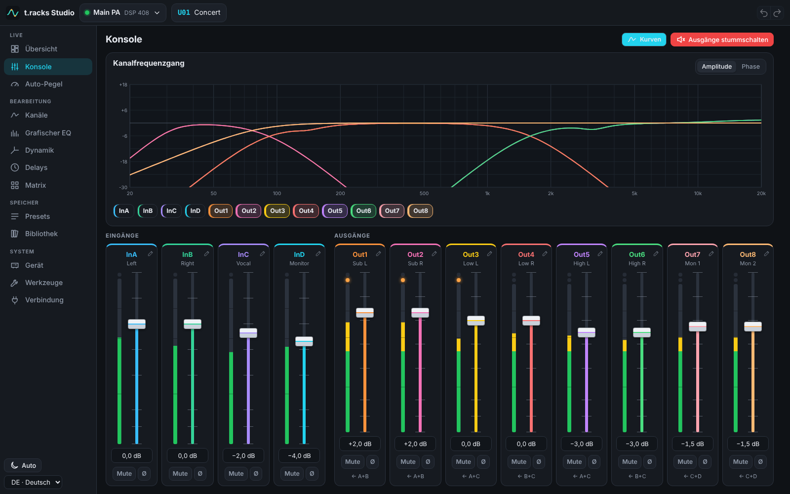
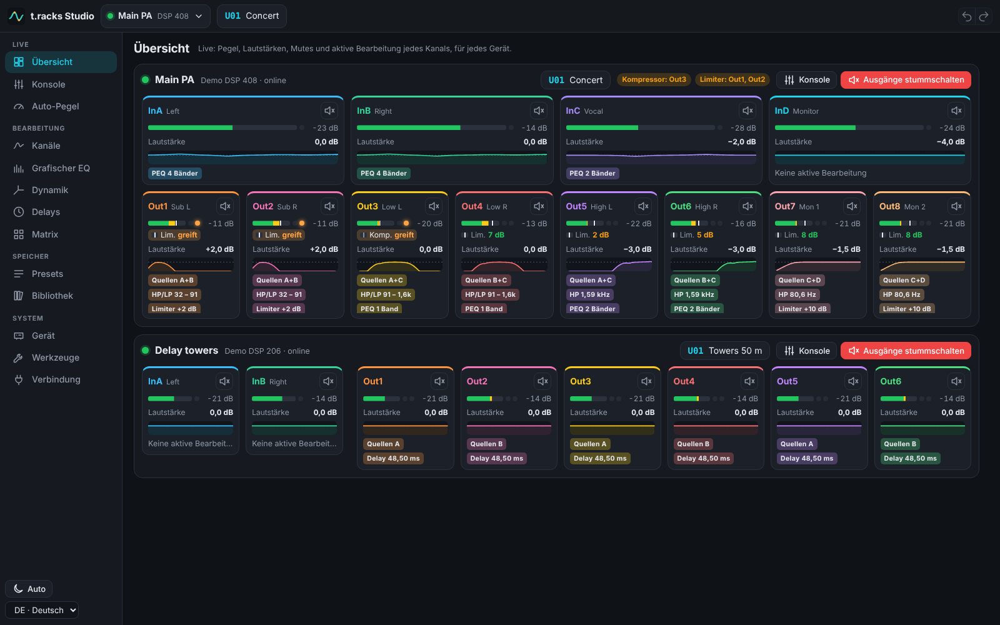
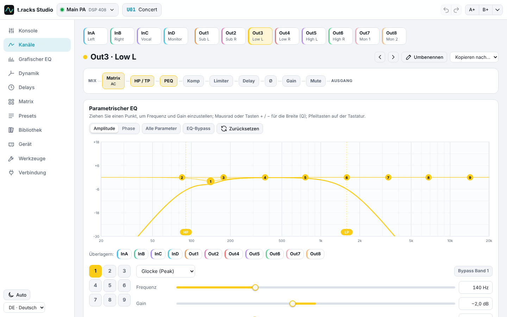
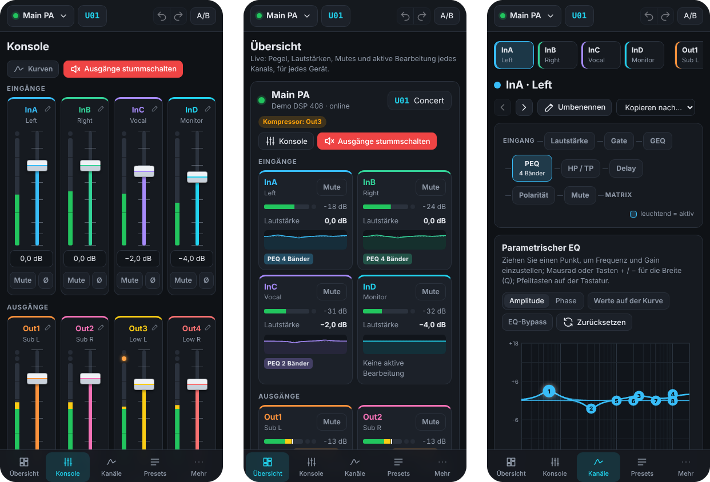

<p align="center">
  
</p>

<h1 align="center">t.racks Studio</h1>

<p align="center">
  Alle Einstellungen Ihrer t.racks DSP 206 und DSP 408, vom Smartphone, Tablet oder Computer aus.
</p>

<p align="center">
  <a href="README.md">English</a> · <a href="README.fr.md">Français</a> · <b>Deutsch</b>
</p>

<p align="center">
  <a href="https://github.com/clabeuhtegrite/t.racks-studio/actions/workflows/ci.yml"></a>
  <a href="LICENSE"></a>
  
</p>



t.racks Studio ersetzt den *Processor Editor*, die nur für Windows erhältliche Software der bei
Thomann angebotenen Lautsprecherprozessoren **t.racks DSP 206** (2 Eingänge, 6 Ausgänge) und
**DSP 408** (4 Eingänge, 8 Ausgänge). Es läuft im Browser jedes Bildschirms im Netzwerk, auf
Deutsch, Englisch oder Französisch, und bietet jedes Menü, jeden Dialog und jede Einstellung des
Windows-Editors ([wo Sie was finden](docs/parite-logiciel-windows.md), auf Französisch).

> [!NOTE]
> t.racks Studio ist ein unabhängiges Projekt, das von Thomann weder entwickelt noch unterstützt
> wird. Jeder Befehl wurde an der Firmware der Geräte geprüft, die in einem Emulator läuft, aber
> noch nicht an einem echten Gerät. Wenn Sie eines besitzen, hilft ein
> [Testbericht](https://github.com/clabeuhtegrite/t.racks-studio/issues/new?template=hardware-test.yml)
> sehr.

## Funktionen

**Alles, was der Windows-Editor kann**

- **Übersicht** (die Startseite): alle verbundenen DSPs auf einen Blick, live: Pegel,
  Lautstärken, Mutes und aktive Bearbeitung jedes Kanals, Übersteuerung, Kompressor und Limiter,
  wenn sie greifen, und an jedem Ausgang die Reserve, bevor Kompressor und Limiter greifen, jeweils
  in einer eigenen Zeile, mit ihren Schwellen auf der Pegelanzeige.
- **Konsole**: Lautstärke, Mute, Polarität und Pegelanzeigen aller Ein- und Ausgänge,
  Frequenzgangkurven der Kanäle. Die Pegelanzeigen lesen sich wie im Windows-Editor: grüner, gelber
  und roter Bereich, und an jedem Ausgang die orange LED, die leuchtet, solange sein Kompressor oder
  Limiter greift.
- **Kanäle**: parametrischer EQ (8 Bänder pro Eingang, 9 pro Ausgang, 9 Filtertypen) auf einer
  Touch-Kurve, Hoch- und Tiefpass (20 Flanken: Butterworth, Bessel, Linkwitz-Riley), Delay, Gate
  (Eingänge), Kompressor und Limiter (Ausgänge), Routing und Eingangsmischung, grafischer
  31-Band-EQ (Eingänge).
- **Alle Kanäle nebeneinander**: grafischer EQ, Dynamik, Delays und Routing-Matrix.
- **Presets**: Abrufen und Speichern der 20 Benutzerspeicher und des Werks-Presets F00, `.prs`-Presets
  und vollständige `.unt`-Sicherungen, kompatibel mit dem Windows-Editor, Werkseinstellungen.
- **Gerät**: Kanalverknüpfungen, Kanäle kopieren, Kanalnamen, Passwortsperre, Einschaltlimit (PTS),
  Geräte-ID und IP-Adresse, Testgenerator (rosa und weißes Rauschen, 31 Sinustöne).
- **Werkzeuge**: RS-232-Befehlscodes mit Frame-Generator, Konsole der ausgetauschten Frames,
  Meldungsprotokoll.

**Und mehr**

- Mehrere DSPs gleichzeitig und beliebig viele Bildschirme, live synchronisiert.
- Zugangscodes: Administrator (alle Einstellungen) und Bediener (nur Lautstärken, Mutes und
  Preset-Abruf).
- Rückgängig und Wiederherstellen.
- Eine Bibliothek für alle Bildschirme: Presets, Sicherungen und Szenen, die mit einem Tipp
  abgerufen werden, ohne einen Gerätespeicher zu belegen, mit Notizen.
- „Ausgänge stummschalten“ mit einem Tipp, Delay-Ausrichtung nach Entfernungen,
  Frequenzweichen-Assistent für 2 oder 3 Wege, Delay- und Wellenlängenrechner.
- Druckbares Einstellungsblatt (oder PDF).
- Am Computer passt jede Seite auf den Bildschirm, ohne Scrollen (von 1280 × 600 bis zum
  Breitbild); auf Smartphone und Tablet liest sie sich von oben nach unten.
- Helles und dunkles Farbschema, als App auf Smartphone und Tablet installierbar (über HTTPS).
- Automatischer Pegelausgleich für Vinyl-Sets: die Bridge gleicht den Pegel von Platte zu Platte
  behutsam an (Ziel, Toleranz, Grenzen), beurteilt jede Platte nach ihren lauten Passagen, wartet
  Breaks ab und drückt nie in einen Limiter. Eine DJ-Vollbildanzeige sagt, wann der Gain am
  Mischpult nachzuregeln ist, und pausiert den Ausgleich für 5 Minuten (Scratchen, Mikrofon); die
  Bilanz des Abends bleibt über einen Neustart erhalten, mit der Zahl der Schreibvorgänge im
  DSP-Speicher.
- Läuft auf einem Raspberry Pi am Netzwerk des Veranstaltungsorts.





<p align="center">
  
</p>

## Schnellstart

Sie benötigen [Node.js](https://nodejs.org) 22.18 oder neuer, unter Windows, macOS oder Linux.
Dann in einem Terminal:

```sh
git clone https://github.com/clabeuhtegrite/t.racks-studio.git
cd t.racks-studio
npm install
npm run build
npm start
```

`npm start` startet die **Bridge**, ein kleines Programm, das mit den DSPs spricht und die
Oberfläche allen Bildschirmen im Netzwerk bereitstellt. Öffnen Sie die angezeigte Adresse:
http://localhost:8080 auf diesem Computer, oder die Adresse `http://192.168…:8080` auf einem
Smartphone oder Tablet im selben Netzwerk.

Fügen Sie Ihre DSPs dann einmalig im Bildschirm **Verbindung** hinzu. t.racks Studio merkt sie
sich: Sie verbinden und trennen sie auf diesem Bildschirm.

| | |
|---|---|
| **Demo** | ein virtueller DSP 206 oder DSP 408, um alles ohne Hardware auszuprobieren |
| **Ethernet** | Suche im Netzwerk oder IP-Adresse des DSP (ab Werk 192.168.1.101) |
| **USB** | ein DSP am Computer, auf dem die Bridge läuft |
| **RS&#8209;232 / RS&#8209;485** | über einen seriellen Adapter (`COM3` unter Windows, `/dev/ttyUSB0` unter Linux); DSPs an einem gemeinsamen RS-485-Bus werden über ihre ID unterschieden |

### Optionen

`npm start -- --help` listet alle auf. Die wichtigsten:

| Option | |
|---|---|
| `--pin Code` | Administrator-Code; ohne ihn kann jeder im Netzwerk alles ändern |
| `--operator-pin Code` | Bediener-Code: nur Lautstärken, Mutes und Preset-Abruf |
| `--port n` | HTTP-Port, standardmäßig 8080 |
| `--data Ordner` | gespeicherte Geräte und Bibliothek, standardmäßig `~/.dsp-studio` |
| `--cert Datei --key Datei` | HTTPS, für die installierbare App sowie für USB und Seriell im Browser eines anderen Computers |

### Linux und USB

Um einen DSP ohne Root-Rechte über USB zu öffnen, installieren Sie die udev-Regel und stecken den
DSP dann ab und wieder an. Für serielle Adapter muss Ihr Benutzer in der Gruppe `dialout` sein.

```sh
sudo cp deploy/raspberry-pi/60-t.racks-dsp.rules /etc/udev/rules.d/
sudo udevadm control --reload-rules
sudo usermod -aG dialout "$USER"   # serielle Adapter; wirksam ab der nächsten Anmeldung
```

### Ohne Bridge

Die kompilierte Oberfläche (`apps/web/dist`) funktioniert auch allein, von jedem Webserver aus.
Chrome und Edge steuern dann selbst einen DSP, der per USB oder seriell am Computer angeschlossen
ist (WebHID, Web Serial): Das ist der **Browser-Modus** des Bildschirms Verbindung. Ethernet braucht
immer die Bridge, da ein Browser keine TCP-Verbindung öffnen kann.

## Auf einem Raspberry Pi

Für eine feste Installation betreibt ein Raspberry Pi am Netzwerk des Veranstaltungsorts t.racks
Studio für alle Bildschirme und startet es beim Einschalten von selbst. Unter Raspberry Pi OS Lite:

```sh
curl -fsSL https://raw.githubusercontent.com/clabeuhtegrite/t.racks-studio/main/deploy/raspberry-pi/install.sh | sudo bash
```

Öffnen Sie dann http://tracks-studio.local/. Die [Raspberry-Pi-Anleitung](docs/raspberry-pi.md)
(auf Englisch) beschreibt die Speicherkarte, die Optionen, eine feste Adresse und die Zugangscodes.

## Eine Demo-Instanz

Damit jeder t.racks Studio ohne DSP ausprobieren kann, betreibt das Docker-Image eine Demo-Instanz:
die Firmware von DSP 206 und DSP 408 im Emulator und ein Demo-DSP, offen für alle, ohne Zugriff auf
das Netzwerk des Servers, und sie kehrt von selbst in ihren Ausgangszustand zurück:

```sh
docker run -d -p 8080:8080 -v tracks-demo:/data ghcr.io/clabeuhtegrite/t.racks-studio:main demo
```

Die [Demo-Anleitung](docs/demo.md) (auf Englisch) beschreibt Docker Compose, Kubernetes, Reverse
Proxys und die Einstellungen.

## Sicherheit

Ohne Codes kann jeder im Netzwerk jede Einstellung ändern: Setzen Sie `--pin`, sobald nicht nur Sie
das Netzwerk nutzen. Die Bridge lehnt Seiten fremder Websites ab (Prüfung des Ursprungs), nimmt
nach mehreren falschen Codes eine Minute lang keine Codes mehr an und sendet nie die dem Werk
vorbehaltenen Befehle (Firmware-Update, Löschen des Speichers) an einen DSP.

## An der echten Firmware geprüft

Die Firmware der DSPs läuft Instruktion für Instruktion in einem Emulator, der zum Projekt gehört
([emulator/](emulator/README.md), auf Französisch), und die Konformitätstests prüfen t.racks Studio
daran. Die Firmware gehört Thomann: Der Emulator lädt sie von der Thomann-Website auf Ihren Computer
herunter, und sie ist nie in diesem Repository enthalten.

## Dokumentation

Vorerst überwiegend auf Französisch:

- [Abgleich mit dem Windows-Editor](docs/parite-logiciel-windows.md): jede Funktion des
  Windows-Editors und wo sie in t.racks Studio zu finden ist.
- [Tests mit echter Hardware](docs/essais-materiel.md): was an einem echten Gerät zu prüfen ist und
  wie man die Frames aufzeichnet, wenn etwas abweicht.
- [Architektur](docs/architecture.md) und [Protokoll der DSPs](docs/protocole.md).
- [Firmware-Emulator](emulator/README.md).
- [Raspberry Pi](docs/raspberry-pi.md), auf Englisch und [auf Französisch](docs/raspberry-pi.fr.md).
- [Demo-Instanz](docs/demo.md), auf Englisch und [auf Französisch](docs/demo.fr.md).

## Entwicklung

```sh
npm test                      # Unit-Tests: Protokoll, Firmware-Konformität, Bridge, Übersetzungen
npm run typecheck
npm run dev:bridge            # eine Bridge mit eigenen Daten (.dev/), dann in einem anderen Terminal:
npm run dev                   # die Oberfläche mit Hot Reload, auf http://localhost:5173
node apps/web/e2e/flows.cjs   # 39 End-to-End-Prüfungen im Browser (Playwright, Bridge gestartet)
```

| Ordner | |
|---|---|
| `packages/protocol` | Frames, Einstellungen, Befehle, Presets, `.prs`- und `.unt`-Dateien, virtueller DSP (TypeScript, ohne Abhängigkeiten) |
| `packages/i18n` | Übersetzungen, gemeinsam für Oberfläche und Bridge |
| `apps/bridge` | die Bridge: USB, Ethernet, Seriell, Erkennung, Web- und WebSocket-Server, Bibliothek |
| `apps/web` | die Oberfläche (React) |
| `emulator` | Firmware-Emulator (Python) und seine Tests |
| `deploy/raspberry-pi` | Installationsskript und Dienst für einen Raspberry Pi |
| `deploy/demo` | Demo-Instanz: Startprogramm, Docker-Compose- und Kubernetes-Dateien |
| `deploy/docker` | Einstiegspunkt des Docker-Images (`Dockerfile` im Hauptverzeichnis) |

### Übersetzungen

Die Oberfläche ist auf Französisch geschrieben, und jeder französische Text ist der Schlüssel seiner
Übersetzung in [`en.json`](packages/i18n/src/en.json) und [`de.json`](packages/i18n/src/de.json).
`npm run i18n` listet die noch zu übersetzenden Texte, und die Tests prüfen, dass jede Übersetzung
die Platzhalter (`{0}`, `{1}`…) ihres Textes behält. Korrekturen sind willkommen; wie man eine
Sprache hinzufügt, steht in [`packages/i18n/src/index.ts`](packages/i18n/src/index.ts).

### Mitwirken

Issues und Pull Requests sind willkommen, auf Deutsch, Englisch oder Französisch. Führen Sie vor
einem Pull Request `npm run typecheck` und `npm test` aus. Die End-to-End-Prüfungen verwenden
virtuelle DSPs; richten Sie sie nie auf einen DSP im Einsatz, da sie seine Presets und seine Sperre
ändern.

## Danksagung

Andere Enthusiasten haben das Protokoll zuerst beschrieben, und ihre Arbeit war der Ausgangspunkt:
[dxtrzlb/z3r0-dsp206](https://github.com/dxtrzlb/z3r0-dsp206),
[gr4per/dsp206](https://github.com/gr4per/dsp206),
[FlexiFlizz/t.racks-DSP-control](https://github.com/FlexiFlizz/t.racks-DSP-control),
[Aeternitaas/dsp-408-ui](https://github.com/Aeternitaas/dsp-408-ui) und
[DoctorRemoteControl/dsp408-protocol](https://github.com/DoctorRemoteControl/dsp408-protocol). Es
wurde kein Code daraus übernommen: Alles wurde neu geschrieben und an der Firmware geprüft.

## Lizenz

[MIT](LICENSE). t.racks Studio wird von Thomann weder entwickelt noch unterstützt oder empfohlen.
„the t.racks“ ist eine Marke von Thomann. Die Firmware der Geräte ist nicht Teil dieses Projekts.
