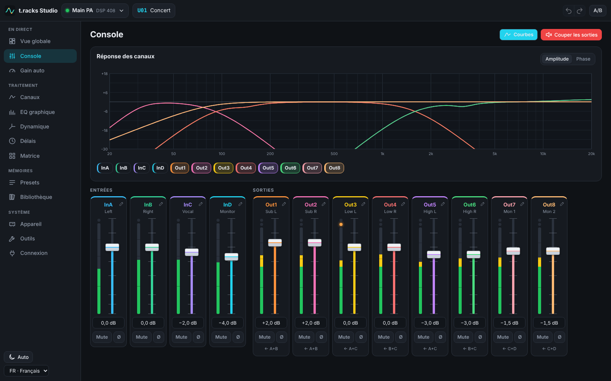
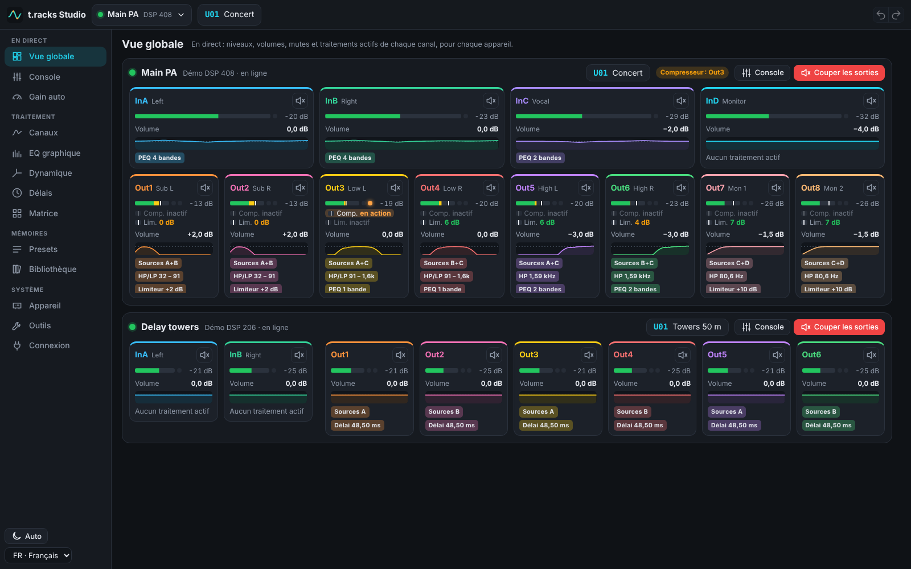
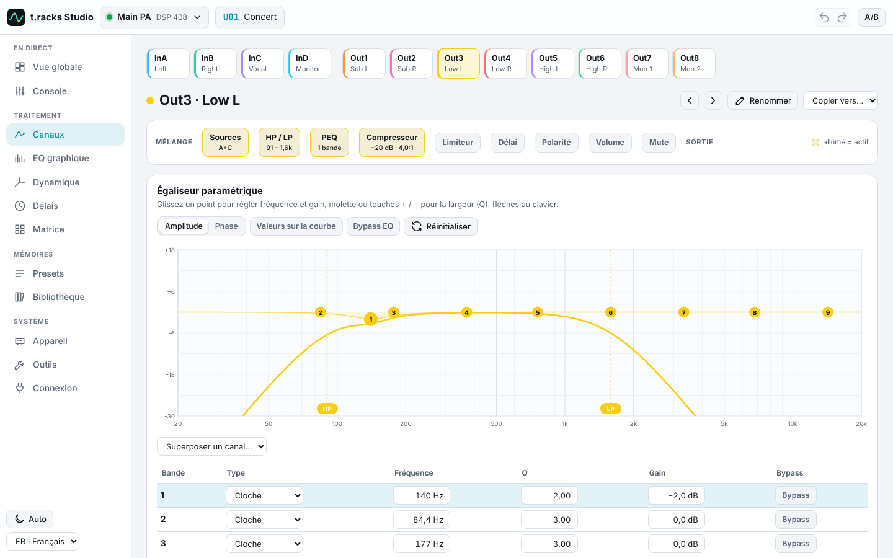
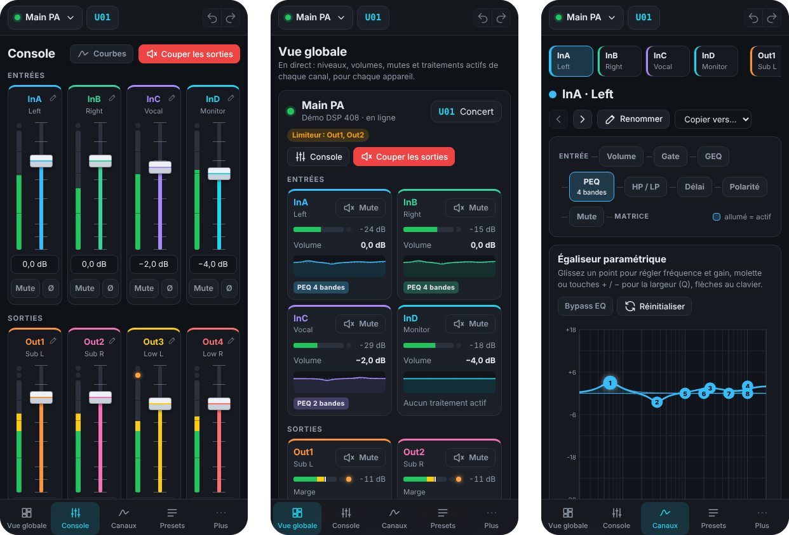

<p align="center">
  
</p>

<h1 align="center">t.racks Studio</h1>

<p align="center">
  Tous les réglages de vos t.racks DSP 206 et DSP 408, depuis un téléphone, une tablette ou un ordinateur.
</p>

<p align="center">
  <a href="README.md">English</a> · <b>Français</b> · <a href="README.de.md">Deutsch</a>
</p>

<p align="center">
  <a href="https://github.com/clabeuhtegrite/t.racks-studio/actions/workflows/ci.yml"></a>
  <a href="LICENSE"></a>
  
</p>



t.racks Studio remplace le *Processor Editor*, le logiciel des processeurs **t.racks DSP 206**
(2 entrées, 6 sorties) et **DSP 408** (4 entrées, 8 sorties) vendus par Thomann, qui n’existe que
sous Windows. Il fonctionne dans le navigateur de n’importe quel écran du réseau, en français,
anglais ou allemand, et garde chaque menu, dialogue et réglage du logiciel Windows
([où trouver chacun](docs/parite-logiciel-windows.md)).

> [!NOTE]
> t.racks Studio est un projet indépendant, ni développé ni soutenu par Thomann. Chaque commande a
> été vérifiée sur le firmware des appareils, qui tourne dans un émulateur, mais pas encore sur un
> vrai boîtier. Si vous en avez un, un [compte rendu d’essai](https://github.com/clabeuhtegrite/t.racks-studio/issues/new?template=hardware-test.yml)
> aide beaucoup.

## Ce qu’on peut faire

**Tout ce que fait le logiciel Windows**

- **Vue globale** (la page d’accueil) : tous les DSP connectés d’un coup d’œil, en direct : niveaux,
  volumes, mutes et traitements actifs de chaque canal, écrêtage, compresseur et limiteur en action,
  et sur chaque sortie la marge qui reste avant que son compresseur et son limiteur agissent, sur
  une ligne chacun, avec leurs seuils marqués sur le vumètre.
- **Console** : volume, mute, polarité et vumètres de toutes les entrées et sorties, courbes de
  réponse des canaux. Les vumètres se lisent comme ceux du logiciel Windows : zones verte, jaune et
  rouge, et sur chaque sortie le voyant orange qui s’allume quand son compresseur ou son limiteur
  agit.
- **Canaux** : égaliseur paramétrique (8 bandes par entrée, 9 par sortie, 9 types de filtres) sur
  une courbe tactile, passe-haut et passe-bas (20 pentes Butterworth, Bessel, Linkwitz-Riley), délai,
  gate (entrées), compresseur et limiteur (sorties), routage et mélange des entrées, égaliseur
  graphique 31 bandes (entrées).
- **Tous les canaux côte à côte** : EQ graphique, dynamique, délais et matrice de routage.
- **Presets** : rappel et enregistrement des 20 mémoires et du réglage d’usine F00, fichiers `.prs`
  et sauvegardes complètes `.unt` compatibles avec le logiciel Windows, retour aux réglages d’usine.
- **Appareil** : liaisons et copie de canaux, noms des canaux, verrouillage par mot de passe,
  limite d’allumages (PTS), ID et adresse IP, générateur de test (bruits rose et blanc, 31 sinus).
- **Outils** : codes de commande RS-232 avec générateur de trames, console des trames échangées,
  journal des messages.

**Et en plus**

- Plusieurs DSP à la fois, et autant d’écrans que l’on veut, synchronisés en direct.
- Codes d’accès : administrateur (tous les réglages) et opérateur (volumes, mutes et rappel de
  presets seulement).
- Annuler et rétablir.
- Une bibliothèque partagée par tous les écrans : presets, sauvegardes et scènes rappelées d’un geste
  sans occuper de mémoire de l’appareil, avec des notes.
- « Couper les sorties » d’un geste, alignement des délais par les distances, assistant de filtrage 2
  ou 3 voies, calculs de délai et de longueur d’onde.
- Fiche des réglages imprimable (ou en PDF).
- Sur un ordinateur, chaque page tient sur l’écran, sans défiler (de 1280 × 600 à l’écran large) ;
  sur un téléphone ou une tablette, elle se lit de haut en bas.
- Thèmes clair et sombre, application installable sur téléphone et tablette (en HTTPS).
- Gain automatique pour les sets vinyles : le pont égalise doucement le niveau d’un disque à l’autre
  (cible, tolérance, limites), juge chaque disque sur ses passages forts, attend la fin des breaks
  et ne pousse jamais dans un limiteur. Un écran DJ plein écran dit quand toucher au gain de la
  table et met le gain automatique en pause 5 minutes (scratch, micro) ; le bilan de la soirée est
  gardé au redémarrage, avec le compte des écritures dans la mémoire du DSP.
- Fonctionne sur un Raspberry Pi branché au réseau de la salle.





<p align="center">
  
</p>

## Démarrage rapide

Il faut [Node.js](https://nodejs.org) 22.18 ou plus récent, sous Windows, macOS ou Linux. Puis, dans
un terminal :

```sh
git clone https://github.com/clabeuhtegrite/t.racks-studio.git
cd t.racks-studio
npm install
npm run build
npm start
```

`npm start` lance le **pont**, un petit programme qui dialogue avec les DSP et sert l’interface à
tous les écrans du réseau. Ouvrez l’adresse qu’il affiche : http://localhost:8080 sur cet
ordinateur, ou celle en `http://192.168…:8080` sur un téléphone ou une tablette du même réseau.

Ajoutez ensuite vos DSP une fois pour toutes, dans l’écran **Connexion**. t.racks Studio s’en
souvient : on s’y connecte et on s’en déconnecte depuis cet écran.

| | |
|---|---|
| **Démo** | un DSP 206 ou DSP 408 virtuel, pour tout essayer sans matériel |
| **Ethernet** | recherche sur le réseau, ou adresse IP du DSP (192.168.1.101 d’origine) |
| **USB** | un DSP branché sur l’ordinateur où tourne le pont |
| **RS&#8209;232 / RS&#8209;485** | par un adaptateur série (`COM3` sous Windows, `/dev/ttyUSB0` sous Linux) ; plusieurs DSP sur un même bus RS-485 se distinguent par leur ID |

### Options

`npm start -- --help` les liste toutes. Les principales :

| Option | |
|---|---|
| `--pin code` | code administrateur ; sans code, toute personne du réseau peut tout régler |
| `--operator-pin code` | code opérateur : volumes, mutes et rappel de presets seulement |
| `--port n` | port HTTP, 8080 par défaut |
| `--data dossier` | appareils mémorisés et bibliothèque, `~/.dsp-studio` par défaut |
| `--cert fichier --key fichier` | HTTPS, pour l’application installable, et pour l’USB ou la série dans le navigateur d’un autre ordinateur |

### Linux et USB

Pour ouvrir un DSP en USB sans être administrateur, installez la règle udev, puis débranchez et
rebranchez le DSP. Les adaptateurs série demandent que votre utilisateur soit dans le groupe
`dialout`.

```sh
sudo cp deploy/raspberry-pi/60-t.racks-dsp.rules /etc/udev/rules.d/
sudo udevadm control --reload-rules
sudo usermod -aG dialout "$USER"   # adaptateurs série ; pris en compte à la prochaine session
```

### Sans le pont

L’interface compilée (`apps/web/dist`) fonctionne aussi seule, depuis n’importe quel serveur web.
Chrome et Edge pilotent alors eux-mêmes un DSP branché sur l’ordinateur en USB ou en série (WebHID,
Web Serial) : c’est le **mode navigateur** de l’écran Connexion. L’Ethernet passe toujours par le
pont, car un navigateur ne peut pas ouvrir de connexion TCP.

## Sur un Raspberry Pi

Pour une installation fixe, un Raspberry Pi branché au réseau de la salle fait tourner t.racks
Studio pour tous les écrans, et le lance tout seul à l’allumage. Sous Raspberry Pi OS Lite :

```sh
curl -fsSL https://raw.githubusercontent.com/clabeuhtegrite/t.racks-studio/main/deploy/raspberry-pi/install.sh | sudo bash
```

Ouvrez ensuite http://tracks-studio.local/. Le [guide Raspberry Pi](docs/raspberry-pi.fr.md)
détaille la carte, les options, l’adresse fixe et les codes d’accès.

## Sécurité

Sans code, toute personne du réseau peut tout régler : définissez `--pin` dès que le réseau n’est
pas le vôtre seul. Le pont refuse les pages d’autres sites (contrôle de l’origine), n’accepte plus
de code pendant une minute après plusieurs erreurs, et n’envoie jamais à un DSP les commandes
réservées à l’usine (mise à jour du firmware, effacement de la mémoire).

## Vérifié sur le vrai firmware

Le firmware des DSP tourne, instruction par instruction, dans un émulateur fourni avec le projet
([emulator/](emulator/README.md)), et les tests de conformité y confrontent t.racks Studio. Le
firmware appartient à Thomann : l’émulateur le télécharge depuis le site de Thomann sur votre
ordinateur, et il n’est jamais inclus dans ce dépôt.

## Documentation

- [Correspondance avec le logiciel Windows](docs/parite-logiciel-windows.md) : chaque fonction du
  logiciel Windows, et où la trouver dans t.racks Studio.
- [Essais sur un vrai appareil](docs/essais-materiel.md) : quoi vérifier, et comment enregistrer les
  trames si quelque chose diffère.
- [Architecture](docs/architecture.md) et [protocole des DSP](docs/protocole.md).
- [Émulateur du firmware](emulator/README.md).
- [Raspberry Pi](docs/raspberry-pi.fr.md), en français et [en anglais](docs/raspberry-pi.md).

## Développement

```sh
npm test                      # tests : protocole, conformité au firmware, pont, traductions
npm run typecheck
npm run dev:bridge            # un pont avec ses propres données (.dev/), puis dans un autre terminal :
npm run dev                   # l’interface avec rechargement à chaud, sur http://localhost:5173
node apps/web/e2e/flows.cjs   # 39 vérifications de bout en bout dans un navigateur (Playwright, pont lancé)
```

| Dossier | |
|---|---|
| `packages/protocol` | trames, réglages, commandes, presets, fichiers `.prs` et `.unt`, DSP virtuel (TypeScript, sans dépendance) |
| `packages/i18n` | traductions, communes à l’interface et au pont |
| `apps/bridge` | le pont : USB, Ethernet, série, découverte, serveur web et WebSocket, bibliothèque |
| `apps/web` | l’interface (React) |
| `emulator` | émulateur du firmware (Python) et ses tests |
| `deploy/raspberry-pi` | script d’installation et service pour un Raspberry Pi |

### Traductions

L’interface est écrite en français, et chaque texte français sert de clé à sa traduction dans
[`en.json`](packages/i18n/src/en.json) et [`de.json`](packages/i18n/src/de.json). `npm run i18n`
liste les textes qui restent à traduire, et les tests vérifient que chaque traduction garde les
emplacements (`{0}`, `{1}`…) de son texte. Les corrections sont bienvenues ; pour ajouter une
langue, voir [`packages/i18n/src/index.ts`](packages/i18n/src/index.ts).

### Contribuer

Tickets et demandes de fusion sont bienvenus, en français, anglais ou allemand. Avant une demande de
fusion, lancez `npm run typecheck` et `npm test`. Les vérifications de bout en bout utilisent des
DSP virtuels ; ne les lancez jamais sur un DSP en service, car elles modifient ses presets et son
verrouillage.

## Remerciements

D’autres passionnés ont d’abord décrit le protocole, et leurs travaux ont servi de point de départ :
[dxtrzlb/z3r0-dsp206](https://github.com/dxtrzlb/z3r0-dsp206),
[gr4per/dsp206](https://github.com/gr4per/dsp206),
[FlexiFlizz/t.racks-DSP-control](https://github.com/FlexiFlizz/t.racks-DSP-control),
[Aeternitaas/dsp-408-ui](https://github.com/Aeternitaas/dsp-408-ui) et
[DoctorRemoteControl/dsp408-protocol](https://github.com/DoctorRemoteControl/dsp408-protocol).
Aucun code n’en est repris : tout a été réécrit et vérifié sur le firmware.

## Licence

[MIT](LICENSE). t.racks Studio n’est ni développé, ni soutenu, ni approuvé par Thomann. « the
t.racks » est une marque de Thomann. Le firmware des appareils ne fait pas partie de ce projet.
