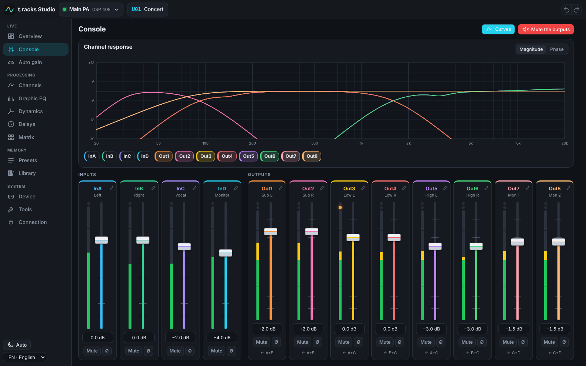
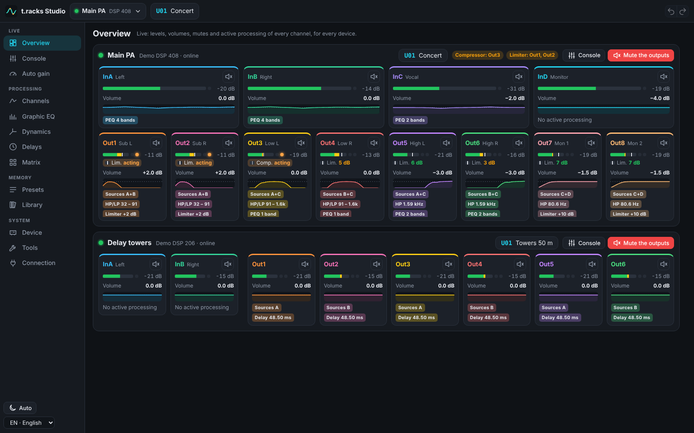
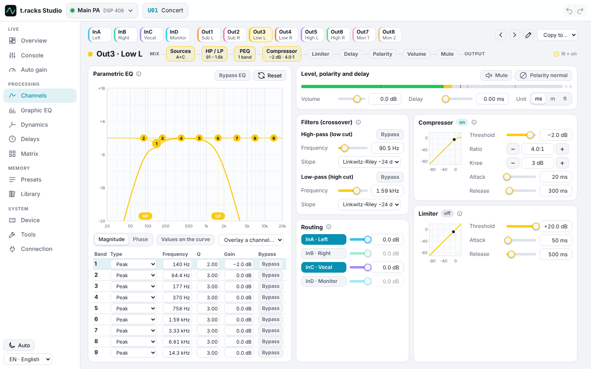
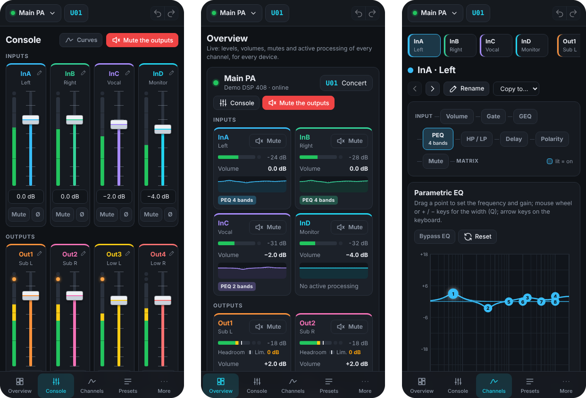

<p align="center">
  
</p>

<h1 align="center">t.racks Studio</h1>

<p align="center">
  Every setting of your t.racks DSP 206 and DSP 408, from a phone, a tablet or a computer.
</p>

<p align="center">
  <b>English</b> · <a href="README.fr.md">Français</a> · <a href="README.de.md">Deutsch</a>
</p>

<p align="center">
  <a href="https://github.com/clabeuhtegrite/t.racks-studio/actions/workflows/ci.yml"></a>
  <a href="LICENSE"></a>
  
</p>



t.racks Studio replaces the *Processor Editor*, the Windows-only software of the **t.racks DSP 206**
(2 inputs, 6 outputs) and **DSP 408** (4 inputs, 8 outputs) loudspeaker processors sold by Thomann.
It runs in the browser of any screen on the network, in English, French or German, and keeps every
menu, dialog and setting of the Windows editor ([where to find each one](docs/parite-logiciel-windows.md),
in French).

> [!NOTE]
> t.racks Studio is an independent project, not made or endorsed by Thomann. Every command has been
> checked against the devices’ own firmware, running in an emulator, but not on a real unit yet. If
> you own one, a [hardware test report](https://github.com/clabeuhtegrite/t.racks-studio/issues/new?template=hardware-test.yml)
> helps a lot.

## Features

**Everything the Windows editor does**

- **Overview** (the home page): every connected DSP at a glance, live: levels, volumes, mutes and
  the processing active on each channel, clipping, compressor and limiter at work, and on each
  output the headroom left before its compressor and limiter act, with their thresholds marked on
  the meter.
- **Console**: volume, mute, polarity and meters of every input and output, response curves of the
  channels. The meters read like the Windows editor’s: green, yellow and red zones, and on each
  output the orange LED that lights while its compressor or limiter acts.
- **Channels**: parametric EQ (8 bands per input, 9 per output, 9 filter types) on a touch curve,
  high-pass and low-pass filters (20 slopes: Butterworth, Bessel, Linkwitz-Riley), delay, gate
  (inputs), compressor and limiter (outputs), routing and input mix, 31-band graphic EQ (inputs).
- **All the channels side by side**: graphic EQ, dynamics, delays and routing matrix.
- **Presets**: recall and store the 20 user memories and the F00 factory preset, `.prs` presets and
  `.unt` full backups compatible with the Windows editor, factory reset.
- **Device**: channel links, channel copy, channel names, password lock, power-on limit (PTS),
  device ID and IP address, test generator (pink and white noise, 31 sine tones).
- **Tools**: RS-232 command codes with a frame generator, console of the frames exchanged, message
  log.

**And more**

- Several DSPs at once, and any number of screens kept in sync live.
- Access codes: administrator (every setting) and operator (volumes, mutes and preset recall only).
- Undo and redo.
- A library shared by every screen: presets, backups and scenes recalled in one tap without using a
  device memory, with notes.
- One-tap “mute the outputs”, delay alignment from distances, 2- and 3-way crossover assistant,
  delay and wavelength calculators.
- Printable settings sheet (or PDF).
- On a computer every page fits the screen, with nothing to scroll (from 1280 × 600 up to wide
  screens); on a phone or a tablet it reads from top to bottom.
- Light and dark themes, app installable on phones and tablets (over HTTPS).
- Automatic gain for vinyl DJ sets: the bridge gently evens out the level from one record to the
  next (target, tolerance, limits), judging each record on its loud parts, waiting out breakdowns
  and never pushing into a limiter. A full-screen DJ screen says when to touch the mixer gain and
  pauses the automatic gain for 5 minutes (scratching, a microphone); the summary of the night is
  kept across restarts, with the count of writes to the DSP’s memory.
- Runs on a Raspberry Pi wired to the venue network.





<p align="center">
  
</p>

## Getting started

You need [Node.js](https://nodejs.org) 22.18 or newer, on Windows, macOS or Linux. Then, in a
terminal:

```sh
git clone https://github.com/clabeuhtegrite/t.racks-studio.git
cd t.racks-studio
npm install
npm run build
npm start
```

`npm start` runs the **bridge**, a small program that talks to the DSPs and serves the interface to
every screen of the network. Open the address it shows: http://localhost:8080 on this computer, or
the `http://192.168…:8080` one on a phone or a tablet of the same network.

Then add your DSPs once, on the **Connection** screen. t.racks Studio remembers them: you connect to
them and disconnect from them on that screen.

| | |
|---|---|
| **Demo** | a virtual DSP 206 or DSP 408, to try everything without hardware |
| **Ethernet** | searches the network, or takes the IP address of the DSP (192.168.1.101 out of the box) |
| **USB** | a DSP plugged into the computer that runs the bridge |
| **RS&#8209;232 / RS&#8209;485** | through a serial adapter (`COM3` on Windows, `/dev/ttyUSB0` on Linux); DSPs sharing an RS-485 bus are told apart by their ID |

### Options

`npm start -- --help` lists them all. The main ones:

| Option | |
|---|---|
| `--pin code` | administrator code; without one, anyone on the network can change everything |
| `--operator-pin code` | operator code: volumes, mutes and preset recall only |
| `--port n` | HTTP port, 8080 by default |
| `--data folder` | remembered devices and library, `~/.dsp-studio` by default |
| `--cert file --key file` | HTTPS, for the installable app, and for USB or serial in the browser of another computer |

### Linux and USB

To open a DSP on USB without being root, install the udev rule, then unplug the DSP and plug it in
again. Serial adapters need your user in the `dialout` group.

```sh
sudo cp deploy/raspberry-pi/60-t.racks-dsp.rules /etc/udev/rules.d/
sudo udevadm control --reload-rules
sudo usermod -aG dialout "$USER"   # serial adapters; takes effect at the next login
```

### Without the bridge

The built interface (`apps/web/dist`) also works on its own, from any web server. Chrome and Edge
then drive a DSP plugged into the computer over USB or serial by themselves (WebHID, Web Serial):
this is the **browser mode** of the Connection screen. Ethernet always needs the bridge, since a
browser cannot open a TCP connection.

## On a Raspberry Pi

For a permanent setup, a Raspberry Pi wired to the venue network runs t.racks Studio for every
screen, and starts it by itself when it is switched on. On Raspberry Pi OS Lite:

```sh
curl -fsSL https://raw.githubusercontent.com/clabeuhtegrite/t.racks-studio/main/deploy/raspberry-pi/install.sh | sudo bash
```

Then open http://tracks-studio.local/. The [Raspberry Pi guide](docs/raspberry-pi.md) covers the
card, the options, a fixed address and the access codes.

## Security

Without codes, anyone on the network can change every setting: set `--pin` as soon as the network
is not yours alone. The bridge refuses pages from other sites (origin check), stops accepting codes
for a minute after several wrong ones, and never sends the commands reserved for the factory
(firmware update, memory erase) to a DSP.

## Tested on the real firmware

The firmware of the DSPs runs, instruction by instruction, in an emulator that comes with the
project ([emulator/](emulator/README.md), in French), and the conformance tests check t.racks
Studio against it. The firmware belongs to Thomann: the emulator downloads it from Thomann’s
website to your computer, and it is never included in this repository.

## Documentation

Mostly in French for now:

- [Windows editor parity](docs/parite-logiciel-windows.md): every function of the Windows editor,
  and where it is in t.racks Studio.
- [Hardware tests](docs/essais-materiel.md): what to check on a real unit, and how to record the
  frames when something differs.
- [Architecture](docs/architecture.md) and [protocol of the DSPs](docs/protocole.md).
- [Firmware emulator](emulator/README.md).
- [Raspberry Pi](docs/raspberry-pi.md), in English and [in French](docs/raspberry-pi.fr.md).

## Development

```sh
npm test                      # unit tests: protocol, firmware conformance, bridge, translations
npm run typecheck
npm run dev:bridge            # a bridge with its own data (.dev/), then in another terminal:
npm run dev                   # the interface with hot reload, on http://localhost:5173
node apps/web/e2e/flows.cjs   # 39 end-to-end checks in a browser (Playwright, bridge running)
```

| Folder | |
|---|---|
| `packages/protocol` | frames, settings, commands, presets, `.prs` and `.unt` files, virtual DSP (TypeScript, no dependency) |
| `packages/i18n` | translations, shared by the interface and the bridge |
| `apps/bridge` | the bridge: USB, Ethernet, serial, discovery, web and WebSocket server, library |
| `apps/web` | the interface (React) |
| `emulator` | firmware emulator (Python) and its tests |
| `deploy/raspberry-pi` | install script and service for a Raspberry Pi |

### Translations

The interface is written in French, and each French text is the key of its translation in
[`en.json`](packages/i18n/src/en.json) and [`de.json`](packages/i18n/src/de.json). `npm run i18n`
lists the texts left to translate, and the tests check that every translation keeps the
placeholders (`{0}`, `{1}`…) of its text. Corrections are welcome; to add a language, see
[`packages/i18n/src/index.ts`](packages/i18n/src/index.ts).

### Contributing

Issues and pull requests are welcome, in English, French or German. Before a pull request, run
`npm run typecheck` and `npm test`. The end-to-end checks use virtual DSPs; never point them at a
DSP in use, since they change its presets and its lock.

## Credits

Other enthusiasts first described the protocol, and their work was the starting point:
[dxtrzlb/z3r0-dsp206](https://github.com/dxtrzlb/z3r0-dsp206),
[gr4per/dsp206](https://github.com/gr4per/dsp206),
[FlexiFlizz/t.racks-DSP-control](https://github.com/FlexiFlizz/t.racks-DSP-control),
[Aeternitaas/dsp-408-ui](https://github.com/Aeternitaas/dsp-408-ui) and
[DoctorRemoteControl/dsp408-protocol](https://github.com/DoctorRemoteControl/dsp408-protocol). No
code was taken from them: everything was written again and checked against the firmware.

## License

[MIT](LICENSE). t.racks Studio is not developed, supported or endorsed by Thomann. “the t.racks” is
a trademark of Thomann. The firmware of the devices is not part of this project.
